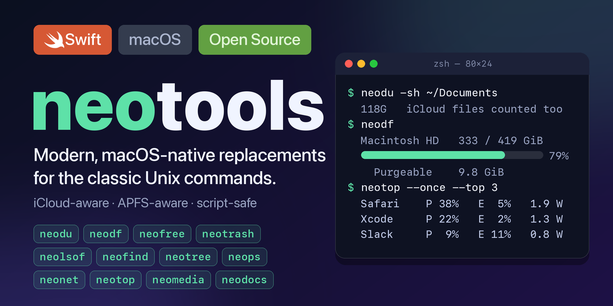

<p align="center"></p>

# neotools: du, df, top, find, lsof, ps and rm, rebuilt for macOS

**Modern, macOS-native replacements for the classic Unix commands that macOS has outgrown, written in Swift.**

neotools is a family of **12 command-line tools** for the Mac terminal. They know what Finder and Activity Monitor know (iCloud,
APFS, purgeable space, the Trash, performance and efficiency cores, the GPU) and the classic tools never learned. Piped, they print
what the original prints, so scripts keep working; on a terminal you get the modern view.

- **`neodu`** and **`neodf`** report disk space the way Finder does: iCloud files that are not on this Mac, purgeable space,
  snapshots, the Trash.
- **`neotop`** is Activity Monitor for the terminal: applications ranked by watts, performance cores, efficiency cores, GPU.
- **`neofree`**, **`neotree`**, **`neops`** and **`neonet`** bring the Linux habits (`free`, `tree`, `ps aux`, `netstat -tulpn`)
  to macOS.
- **`neofind`**, **`neolsof`** and **`neotrash`** are `find`, `lsof` and `rm` with Finder tags, deleted-but-open files and an
  undo.
- **`neomedia`** and **`neodocs`** convert, shrink and inspect photos, videos, PDFs, Word, Excel, CSV and Parquet files with
  nothing else to install.
- **`neo-setup`** is optional: it makes `du` run `neodu`, `df` run `neodf` and so on in your shell, and takes it all back out
  again.

## Install

With [Homebrew](https://brew.sh):

```sh
brew install reachdevel/tap/neotools
```

That installs all twelve commands and `neo-setup` (macOS 14 or newer, see [Requirements](#requirements)). Check it:

```sh
neodf          # your disks, the way Finder sees them
neotop --once  # which applications use the power right now
```

Want to type `du` and get `neodu`? Run `neo-setup` once (see [below](#type-du-get-neodu)). Prefer to build it yourself?
See [Build from source](#build-from-source).

## The commands

| command | replaces | what you get |
|---|---|---|
| [`neodu`](docs/commands/neodu.md) | `du` | **`du` with iCloud awareness.** It sees the gigabytes that "Optimize Mac Storage" moved to the cloud and sizes them the way Finder does, up to 4x faster on big trees. `--local` gives classic `du` numbers. |
| [`neodf`](docs/commands/neodf.md) | `df` | **`df` that understands APFS.** One block per container, purgeable space, local snapshots and the Trash, with the free space Finder shows. |
| [`neotop`](docs/commands/neotop.md) | `top` | **Activity Monitor for the terminal.** Applications instead of helper processes, ranked by watts, with performance cores, efficiency cores, GPU, memory, network and disk in one table. |
| [`neofree`](docs/commands/neofree.md) | (`free`, which macOS lacks) | **`free` for macOS.** The familiar table with Activity Monitor's numbers, and the memory pressure. |
| [`neotrash`](docs/commands/neotrash.md) | `rm` | **Delete with an undo.** Same options as `rm`, but files go to the Trash like in Finder, so "Put Back" works. |
| [`neofind`](docs/commands/neofind.md) | `find` | **`find` for the Mac you have.** Finder tags, purgeable files, files evicted to iCloud, quarantined downloads; up to 5x faster on large trees. |
| [`neolsof`](docs/commands/neolsof.md) | `lsof` | **Who has it open?** Files, ports, deleted files that still use space, and who is recording audio, up to 7x faster, and without waiting for DNS. |
| [`neotree`](docs/commands/neotree.md) | (`tree`, which macOS lacks) | **A folder tree with sizes** that folds `node_modules`, `.git`, virtualenvs and build output into one line each. |
| [`neops`](docs/commands/neops.md) | `ps` | **`ps aux`, `ps -ef`, `--forest` and `--sort=-%cpu`** the way Linux users type them, on macOS. |
| [`neonet`](docs/commands/neonet.md) | `ifconfig`, `netstat` | **The network at a glance.** Interfaces, sockets with their programs, routes and DNS in one read-only command (`neonet -tulpn`). |
| [`neomedia`](docs/commands/neomedia.md) | `sips`, `ffmpeg`, `exiftool`, `cwebp` | **Photos and videos in one tool.** Inspect, convert (HEIC, JPEG, AVIF, WebP, MP4...), shrink, and take the location out. |
| [`neodocs`](docs/commands/neodocs.md) | `qpdf`, `pdftotext`, `pandoc`... | **PDF, Word, Excel, CSV and Parquet in one tool.** Convert, merge, split, extract text and pictures, OCR, shrink scans, strip metadata. |
| [`neo-setup`](docs/commands/neo-setup.md) | | **Type `du`, get `neodu`.** Optional shell functions so that `du` runs `neodu`, `df` runs `neodf` and so on. Removable in one command. |

Every command has `--help`, `--version` and `--plain`. If you only try two, try `neodf` and `neotop`.

## Why not keep using the originals?

- **They cannot see what macOS has become.** iCloud, APFS containers, purgeable space, the Trash, efficiency cores and the GPU did
  not exist when `du`, `df` and `top` were written. What they print is not what Finder and Activity Monitor show.
- **You lose nothing.** Piped, a neo command prints what the original prints, with the same exit codes. `--plain` gives the old
  behaviour, and for `neofind`, `neolsof`, `neotrash` and `neops` it hands the job to the real command.
- **They are fast.** Tree walking, open-file listing and media work use bulk system calls, several threads and Apple's hardware.
  The honest exceptions (tiny jobs lose a few milliseconds to start-up) are in [docs/performance.md](docs/performance.md).
- **Nothing else to install.** They use the frameworks that ship with macOS plus a few small open source codecs that are compiled
  in. No Python, no ImageMagick, no ffmpeg, no Office.

### When to keep the original

For a one-off script that must run unchanged on every Mac, call the system command by its full path (for example `/usr/bin/du`
or `/bin/ps`). Everywhere else a neo command is the same command with the numbers corrected.

## Quick start

```sh
# disk space
neodu -sh ~/Library/Mobile\ Documents     # iCloud-aware sizes
neodu --local -sh ~/Library               # exactly what du counts: only what is on this Mac
neodf                                     # volumes, containers, purgeable space, snapshots
neodf --json | jq .                       # exact bytes for scripts

# memory and processes
neofree -h
neops aux --sort=-%cpu | head
neotop                                    # live view; q quits, ? shows the keys
neotop --once --expand "Google Chrome"    # one table; the roles inside an application

# files
neofind . -type f -size +100M -mtime +30d --purgeable
neotree --sort size --dirsfirst src
neotrash -r build dist                    # to the Trash, undoable from Finder

# network and open files
neonet -tulpn                             # listening sockets with their programs
neolsof -i :8080                          # who is using port 8080
neolsof --mic                             # who is recording audio right now

# documents and media
neodocs convert report.docx --to pdf
neodocs text scan.pdf | grep -i total
neodocs split book.pdf --pages 12-20
neomedia info Pictures --sort size --reverse
neomedia shrink Pictures -r --larger 5M --max 1920 --out small
```

## Type `du`, get `neodu`

The goal of `neo-setup` is that you keep typing the commands you know and get the neo ones:

```sh
neo-setup            # a few pages: which shells, which commands
neo-setup --install  # every command in every shell, no questions
neo-setup --status   # what is set up now
neo-setup --uninstall
```

After `neo-setup --install`, `du` runs `neodu`, `df` runs `neodf`, and `find`, `lsof`, `tree`, `top`, `ps`, `rm`, `ifconfig` and
`netstat` do the same; `free`, `media` and `docs` exist as short names. Things to know:

- The functions exist in **interactive shells only** (zsh, bash, fish). Scripts, cron and IDE tasks keep running the system
  commands, so nothing that already works can change.
- `ps` then speaks the options of **Linux** (`ps aux`, `ps -ef`), not those of macOS `ps`. A script that needs the macOS one
  writes `/bin/ps`.
- `rm` then **moves to the Trash** and does not free space until the Trash is emptied. `/bin/rm` still deletes for good.
- `ifconfig` and `netstat` answer through `neonet` only in the forms it understands; every other form goes to the original.
- If a neo command is removed, the function falls back to the original. `neo-setup --uninstall` takes everything out again.
- It never touches `/usr/bin`, which System Integrity Protection protects.

## Under the hood

Most of the work is done by Apple's own frameworks, and the parts that matter are written here, not borrowed:

- **A PDF engine of our own.** Merging, splitting, counting pages, taking pictures out and stripping metadata read and write the
  structure of the file directly, copy pages as they are and keep fonts and images byte for byte. PDFKit is used only for files the
  engine does not take (damaged, password-protected).
- **Word and Excel without Office.** `.docx` and `.xlsx` (and the zip and XML under them) are read and written by neotools, tables
  to and from CSV, JSON and Parquet included.
- **MKV and WebM without ffmpeg.** A Matroska reader of our own opens them; VP8, VP9, AV1, Vorbis and FLAC are decoded by small
  open source libraries that are compiled in, and an MKV can be remuxed to MP4 without re-encoding.
- **Hostile files do not crash it.** Sizes and counts read from a file are checked before they size a buffer or a loop; the tests
  feed it damaged and malicious files on purpose.
- **Tested against the originals.** The suite (over 500 tests) runs the real command and the neo command side by side and compares
  stdout, stderr and the exit status.

## What neotools is

- A **family of commands**, one executable each, all with the prefix `neo`.
- **Script-safe.** Decorations (spinners, bars, colours, notes) appear only when the output is a terminal. A pipe gets plain text.
  `--plain` turns decorations off everywhere, `--json` gives machine-readable output.
- **Metadata only.** The file commands never open your files, so they never trigger an iCloud download by accident.
- Built on **Apple's own libraries**, plus a few small open source codecs that are compiled in (see
  [THIRD_PARTY_NOTICES.md](THIRD_PARTY_NOTICES.md)). Nothing to install at run time.

## What neotools is not

- It is **not coreutils in Swift.** `cat`, `echo`, `head`, `sort` and friends gain nothing from macOS knowledge, so they are out of
  scope; use GNU coreutils or uutils for those.
- It does **not replace `/usr/bin`.** That folder is protected by System Integrity Protection and neotools never touches it.
  `neo-setup` can put shell functions in front of the system commands, and removes them again. See below.
- It is **not portable.** It is macOS only, and uses macOS APIs on purpose.
- It does **not run other programs to read numbers.** The only exception is `neops`, which reads one table from `/bin/ps`.

## Requirements

- macOS 14 (Sonoma) or newer. neotools is developed and tested on **macOS 26 with Apple silicon** (a MacBook Air M1). Other
  versions and Intel Macs should work but are not tested; please report what you find.
- To build: the Swift 6 toolchain (Xcode 16 or newer, or a Swift 6 toolchain from swift.org).
- `neotop` is built for Apple silicon (the split between performance and efficiency cores).

## Build from source

```sh
git clone https://github.com/reachdevel/neotools.git
cd neotools
swift build -c release
```

The commands are in `.build/release/`. Each one needs the resource bundle `neotools_NeoCore.bundle` (the translations of
its messages) **next to it**. Copy the commands together with the bundle:

```sh
install -d /usr/local/bin
cp -R .build/release/neo* .build/release/neotools_NeoCore.bundle /usr/local/bin/   # skip the *.dSYM folders if you like
```

A command that is copied away without its bundle says `translation files not found next to the program` and exits with 1
whenever it needs to print human text. Piped output does not need the bundle. Run the tests with `swift test` (a couple of
minutes; see [CONTRIBUTING.md](CONTRIBUTING.md)).

## How the commands behave

- **Same text as the original when piped.** `neodu | sort -n` prints `du`'s lines. On a terminal you may get a spinner, a live
  table and colours.
- **`--plain`** (or `NEO<COMMAND>_PLAIN=1`, `CI`, `TERM=dumb`, a pipe) turns every decoration off. For `neofind`, `neolsof`,
  `neotrash` and `neops`, `--plain` hands the job to the **real** command (`find`, `lsof`, `rm`, `ps`) with your arguments, which is
  also how you reach the options a neo command does not implement.
- **`--json`** is available in the commands whose output is a table or a list (`neodf`, `neofree`, `neolsof`, `neofind`, `neotree`,
  `neonet`, `neotop`, `neomedia`, `neodocs`).
- **Exit codes** are the original's (`64` for usage errors in the BSD commands, `1` for failures, `127`/`126` when an original
  cannot be found or run).
- **Language.** Everything a neo command adds (help, notes, summaries, table headers) is available in English and Turkish and
  follows `NEO_LANG`, then `LC_ALL`, `LC_MESSAGES`, `LANG`. `NEO_LANG=en` gives stable English for scripts. Messages that imitate
  an original (`du`'s errors, `df`'s columns, ...) are never translated, so scripts keep working. More languages are welcome and
  need no Swift: see the [translation guide](docs/TRANSLATING.md).
- **Safety.** `neodocs` and `neomedia` never overwrite a file that exists: results are written next to the original with a new
  name, or into `--out`, and a name that is taken is skipped and said. When a result must take the original's name, the original
  goes to the Trash first. `--trash-original` is how an original goes away, and it goes to the Trash, never to oblivion.

## Performance

Measured on a MacBook Air M1 (8 cores, 16 GB), macOS 26, APFS, a release build, with [hyperfine](https://github.com/sharkdp/hyperfine),
the originals called by their full path. Every case started only when the CPU had been at least 75% idle. Warm cache unless it says
otherwise. Full tables, the method and the places where neotools **loses** are in [docs/performance.md](docs/performance.md).

| case | original | neotools | |
|---|---:|---:|---|
| `du -sk /Applications` (597,000 files) | 8.96 s | 2.28 s | **3.9x faster** |
| `du -ak /opt/homebrew` (a line per file) | 1.56 s | 0.80 s | **2.0x faster** |
| `find /Applications` (every path) | 11.0 s | 2.14 s | **5.2x faster** |
| `tree -a /opt/homebrew` | 3.82 s | 1.56 s | **2.5x faster** |
| `lsof -n -i` | 64 ms | 9.4 ms | **6.8x faster** |
| `lsof -n` (every open file) | 157 ms | 86 ms | **1.8x faster** |
| `top -l 1` / `neotop --once` | 440 ms | 268 ms | **1.6x faster** |
| pages 1-10 of a PDF to PNG (`pdftoppm`) | 2.23 s | 0.29 s | **7.6x faster** |
| remove the metadata of a PDF (`exiftool -all=`) | 100 ms | 15.5 ms | **6.5x faster** |
| 10 s of 1080p H.264 to 720p (`ffmpeg`) | 1.62 s | 0.62 s | **2.6x faster** |
| HEIC to JPEG (`sips`) | 153 ms | 159 ms | same |
| `ps aux` | 60 ms | 62 ms | same |
| `df -h` | 1.4 ms | 3.7 ms | 2.7x slower |
| `rm` of one file / `neotrash` | 1.6 ms | 46 ms | 29x slower |

The honest reading: tree walking, open-file listing and media work are faster, because they use bulk system calls, several
threads and Apple's hardware. Anything tiny loses a few milliseconds to the start-up of a Swift program (3.4 to 4.0 ms against
1.2 ms for a C program). Putting a file in the Trash the way Finder does costs about 40 ms by itself.

## Limits worth knowing

- Tested on one machine (Apple silicon, macOS 26). macOS 14 and 15 and Intel are untested.
- `neotop` reads the processes of other users and the kernel by name only; their power is derived from the totals. Run with
  `sudo` for more. It uses the undocumented IOReport library for the power figures; if that is missing the hardware watts are
  not shown, and nothing else changes.
- `neomedia` and `neodocs` have documented limits (RAW is rendered, not developed; Word layout is approximated; Pages, Numbers
  and Keynote files are converted by the Apple apps; `xls` and `ppt` are not read). Each command page lists them.
- `neodocs` does not use Microsoft Office or LibreOffice. For a faithful PDF of a Word file use `--app` (Pages).

## Project

- [ROADMAP.md](ROADMAP.md): what comes next.
- [TODO.md](TODO.md): open tasks by topic, with a place for your name.
- [CONTRIBUTING.md](CONTRIBUTING.md): build, test, code rules, how to add a command.
- [docs/TRANSLATING.md](docs/TRANSLATING.md): how to translate neotools into your language and send it to the project.
- [CHANGELOG.md](CHANGELOG.md): what changed in each version.
- [SECURITY.md](SECURITY.md): how to report a vulnerability.
- [THIRD_PARTY_NOTICES.md](THIRD_PARTY_NOTICES.md): the open source code that is compiled in, and its licences.
- [LICENSE](LICENSE): MIT.

## Author

neotools is written by **Levent Kurt** (<reachdevel@gmail.com>) and released under the MIT licence. Bug reports, ideas and pull
requests are welcome: see [CONTRIBUTING.md](CONTRIBUTING.md).
